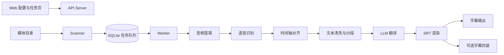

# 从视频语音到翻译字幕的完整流程

本文根据当前仓库实现整理，说明 SubtitlePipeline 如何从媒体目录中的视频自动生成字幕，包括操作步骤、内部阶段、配置含义、输出规则以及失败后的恢复方式。

## 1. 系统最终完成的事情

输入是一个包含语音的视频文件，典型输出如下：

```text
输入：电影.mkv
输出：电影.forced.bilingual.srt
```

系统会依次完成音频提取、语音识别、时间轴对齐、文本清洗、LLM 翻译、SRT 渲染，并可按配置将字幕后封装回 MKV。

翻译是可选步骤。关闭翻译时，系统仍会生成源语言字幕；开启翻译后，默认生成“原文 + 译文”的双语字幕。

## 2. 运行架构

Docker 容器由 Supervisor 启动三个进程，它们共享同一个 SQLite 数据库：

| 进程 | 职责 | 入口 |
|---|---|---|
| API Server | 提供 Web 页面、配置、任务、日志和模型管理 API | `backend/app/api_server.py` |
| Scanner | 周期扫描输入目录，把新视频加入任务队列 | `backend/app/scanner_process.py` |
| Worker | 按顺序领取任务并执行字幕流水线 | `backend/app/worker_process.py` |

查询、页面等数据库操作与后台写入通过 SQLite WAL 模式并发执行。Scanner 和 Worker 只在初始化完成后工作。



## 3. 从零开始的操作流程

### 3.1 准备目录

Docker Compose 默认挂载以下目录：

| 容器路径 | 默认宿主机路径 | 用途 |
|---|---|---|
| `/data` | `./data` | 待处理媒体目录 |
| `/output` | `./output` | 不写回源目录时的统一输出目录 |
| `/models` | `./models` | ASR 与强制对齐模型 |
| `/config` | `./config` | SQLite 数据库、配置和工作目录 |

启动 CPU 版本：

```bash
docker compose up -d
```

启动 NVIDIA GPU 版本：

```bash
docker compose -f docker-compose.gpu.yml up -d
```

随后访问 `http://localhost:8000`。

### 3.2 完成首次引导

首次引导按五步配置：

1. **路径配置**：设置输入目录，并决定字幕写回源文件目录，还是输出到 `/output`。
2. **模型准备**：下载一个 ASR 模型，选择该模型并确认其状态为 `installed`。也可以把已有模型放到 `/models`。
3. **语言与字幕**：设置视频源语言、是否生成双语字幕，以及双语“合并显示”或“分离显示”。
4. **翻译配置**：启用翻译，填写 LLM 类型、API 地址、API Key、模型、目标语言和内容类型；可先点击“测试连接”。
5. **完成确认**：检查摘要，激活选中的 ASR 模型，保存路径、字幕和翻译配置，并把系统标记为初始化完成。

初始化完成后，Scanner 才会开始扫描，Worker 才会开始领取任务。

### 3.3 放入视频

把视频放进已配置的输入目录。默认允许：

```text
.mp4  .mkv  .mov  .avi
```

如需支持 `.wmv` 或 `.m4v`，需要在“文件”配置的允许扩展名中显式加入。默认文件大小范围是 **128 MB 至 8192 MB**；小于 128 MB 的测试视频不会入队，测试前应临时调低 `file.min_size_mb`。

### 3.4 观察任务

在“任务”页面查看状态和处理阶段。新文件通常先显示为 `pending / queued`，被 Worker 领取后变为 `processing`。处理完成后，页面会给出 SRT 路径；开启字幕封装时还会给出 MKV 路径。

## 4. 内部完整流程

### 4.1 扫描和去重

Scanner 每隔 `file.scan_interval_seconds` 秒递归扫描输入目录，默认间隔为 5 秒。

一个文件需要同时满足以下条件才会创建任务：

- 扩展名在允许列表中。
- 文件大小位于 `min_size_mb` 和 `max_size_mb` 之间。
- 文件大小和修改时间连续两次扫描保持一致，即 `stable_hits >= 2`。正在复制的文件不会立即入队。
- 同一路径、文件大小和修改时间没有已经创建过的任务。
- 同一路径当前没有 `pending` 或 `processing` 任务。

Scanner 会跳过：

- `.subpipeline` 中间产物目录。
- 已配置的封装输出文件，例如默认后缀为 `.subbed.mkv` 的文件。
- 当 `output_to_source_dir=false` 时，如果输入范围包含 `/output`，则跳过其内部文件。

视频按“目录层级较浅优先、目录创建时间较新优先、文件名”排序入队。Worker 领取时也优先目录创建时间较新的任务。

任务被领取时，系统会把当前会影响结果的配置保存为 `config_snapshot`。因此：

- 任务在排队但尚未领取时，后续修改配置会影响它。
- 任务已经开始处理后，后续配置修改不会改变该任务使用的快照。

### 4.2 提取音频

**阶段名：** `extract_audio`

FFmpeg 从源视频提取单声道音频，并重采样到配置的采样率：

```text
ffmpeg -y -i <video> -vn -ac 1 -ar <sample_rate> <audio>
```

默认音频格式为 WAV，采样率 16000 Hz。音频提取整体受 7200 秒超时限制。

正常中间目录为：

```text
<视频所在目录>/.subpipeline/<视频stem>/audio.wav
```

如果视频目录不可写，系统回退到：

```text
<processing.work_dir>/<task_id>/audio.wav
```

并写入一条警告日志。

### 4.3 语音识别

**阶段名：** `run_asr`

ASR Provider 根据选中的模型确定。当前支持：

| Provider | 模型示例 | 适用场景 | 主要行为 |
|---|---|---|---|
| WhisperX | `whisperx-small` | 默认、追求稳定时间轴 | Whisper 转录后执行独立对齐 |
| Faster-Whisper | `faster-whisper-large-v3` | 快速预览、资源受限 | CTranslate2 推理，可启用 VAD 和词级时间戳 |
| Anime-Whisper | `anime-whisper` | 日语动漫对白 | 面向日语和对话场景优化；源语言自动时默认日语 |
| Qwen-ASR | `qwen3-asr-0.6b`、`qwen3-asr-1.7b` | 多语言和复杂内容 | Transformer 转录，可配合 Qwen 强制对齐器输出精细时间戳 |

`subtitle.source_language` 同时承担两个作用：

- 非 `auto` 时作为 ASR 语言提示。
- 不生成翻译字幕时，用于字幕文件模板中的 `{lang}`。

不能把“源语言”当作目标翻译语言。目标语言来自 `translation.target_languages`。

ASR 输出统一规范为片段列表：

```json
{
  "start": 1.23,
  "end": 4.56,
  "text": "识别出的原文字幕"
}
```

结果保存到 `asr_result.json`，同时记录识别语言、设备、音频路径和实际 Provider。

### 4.4 时间轴对齐

**阶段名：** `align_segments`

对齐用于提高每条字幕开始和结束时间的准确性。`whisper.align_provider` 支持：

| 值 | 行为 |
|---|---|
| `auto` | WhisperX 任务继续使用 WhisperX 对齐；其他 ASR 在有 `qwen3-forced-aligner` 时使用 Qwen 强制对齐，否则直接使用 ASR 自带时间戳 |
| `whisperx` | 使用 WhisperX 对齐器 |
| `qwen-forced` | 使用本地 `qwen3-forced-aligner`；模型缺失时任务失败 |
| `none` | 跳过二次对齐，直接使用 ASR 时间戳 |

如果使用非 WhisperX ASR，建议在模型管理页额外下载 `qwen3-forced-aligner`，否则只能依赖 ASR 内置的时间戳估算。

对齐后的片段保存到 `aligned_segments.json`。

### 4.5 文本清洗和字幕分段

**阶段名：** `text_process`

系统采用较保守的清理策略，依序执行：

1. 将时间戳四舍五入到 0.01 秒，修复 `end <= start` 的异常。
2. 删除明显重复循环，例如同一字符或短语异常重复。
3. 合并紧邻的极短碎片。
4. 合并时长不超过 0.8 秒、字数很少且相邻间隔不超过 3 秒的孤立短片段。
5. 将超过 7 秒的长片段按标点优先切分，没有标点时按字符比例切分并估算时间。
6. 删除文本完全相同的连续片段。
7. 归一化空白，并在缺失时补充末尾标点。

这一阶段决定后续翻译的文本单元和 SRT 的条目数量。结果保存到 `processed_segments.json`。

### 4.6 使用 LLM 翻译

**阶段名：** `translate`

当 `translation.enabled=false` 时，本阶段直接返回空翻译，后续只生成源语言字幕。

启用翻译后，系统对 `translation.target_languages` 中的每种语言依次翻译。支持的服务类型包括：

- OpenAI Chat Completions
- OpenAI Responses
- OpenAI Compatible
- Anthropic Messages
- LM Studio
- Ollama

API Base URL、模型和 API Key 均可配置。LM Studio 与 Ollama 可以使用空 API Key；远端 OpenAI 兼容服务通常需要 Key。

翻译过程具有以下特征：

- 每块最多 15 条字幕。
- 当总条目数超过 15 时，每块附带前后各最多 5 条作为上下文。
- 提示词要求模型按 `编号|译文` 返回，保持编号和行数不变。
- 先尝试解析编号行，再兼容 JSON 数组、代码围栏和仅有文本行的结果。
- 如果返回结果缺少连续尾部，会保留已经成功的前缀，仅重试剩余部分，最多进行 3 次部分重试。
- 触发服务限流时采用指数退避，单个分块最多重试 5 次。
- 某种语言整体失败时，会按 `translation.max_retries` 再重试该语言。
- 极端情况下少量缺失行会回退为原文，避免整条字幕时间轴错位。

内容风格可选通用、电影/电视剧、纪录片、动漫、技术讲座、综艺/脱口秀或新闻。`translation.custom_prompt` 非空时，会替换内置风格提示词。

每种目标语言得到与原分段一一对应的译文列表，并保存到 `translations.json`。

### 4.7 渲染 SRT

**阶段名：** `subtitle_render`

SRT 使用清洗后的原片段时间轴，每个时间轴条目对应一次翻译结果。实际输出取决于设置：

| 配置 | 生成文件 | SRT 内容 | 模板中的 `{lang}` |
|---|---|---|---|
| 翻译关闭 | 一个源语言字幕 | 原文 | `subtitle.source_language`；若为 `auto` 则写 `auto` |
| 翻译开启、双语开启、模式为 `merge` | 一个字幕，通常只使用第一个目标语言 | 第一行原文，第二行译文 | `bilingual` |
| 翻译开启、双语开启、模式为 `separate` | 每种目标语言一个字幕 | 仅译文 | 目标语言代码 |
| 翻译开启、双语关闭、模式为 `merge` | 每种目标语言一个字幕 | 第一行原文，第二行译文 | 目标语言代码 |
| 翻译开启、双语关闭、模式为 `separate` | 每种目标语言一个字幕 | 仅译文 | 目标语言代码 |

默认模板是：

```text
{stem}.forced.{lang}.srt
```

默认配置是“双语 + 合并显示 + 中文”，因此默认文件名示例为：

```text
电影.forced.bilingual.srt
```

如果使用 `{stem}.{lang}.srt`，双语开启且 `merge` 时输出为 `电影.bilingual.srt`；双语开启且 `separate` 时输出为 `电影.zh.srt`。

这里存在一个当前实现与配置语义不一致的行为：`bilingual=false` 没有被用作最终内容类型的总开关。后端仍会读取隐藏的 `bilingual_mode`：

- 如果关闭双语前的模式是 `merge`，即使 `bilingual=false`，也会为每种目标语言生成“原文 + 译文”。
- 只有关闭双语且模式为 `separate`，才会为每种目标语言生成仅译文。

设置页在关闭双语后会禁用模式选择，但不会把 `bilingual_mode` 自动改成 `separate`。因此，期望“关闭双语后只输出译文”时，不能只切换 `bilingual`，还需要确认该隐藏配置已经为 `separate`。

输出目录由 `file.output_to_source_dir` 决定：

- `true`：写到源视频同目录。
- `false`：写到 `SUBPIPELINE_OUTPUT_DIR`，默认 `/output`。

统一输出模式不会复刻源目录层级；若多个不同目录中的视频具有相同文件名，可能生成同名 SRT 并互相覆盖。

### 4.8 保存最终结果

**阶段名：** `output_finalize`

系统把 SRT 路径、音频路径、设备、翻译语言和文件键写入：

```text
<processing.work_dir>/<task_id>/artifacts.json
```

随后任务被标记为 `done`，进度为 100%。如果任务启用了封装，最终阶段还会记录 `mux_path`。

### 4.9 可选字幕封装

**阶段名：** `mux`

当 `mux.enabled=true` 时，FFmpeg 执行以下操作：

- 复制原视频的第 1 条视频流和第 1 条音频流。
- 将本次生成的每个 SRT 作为独立字幕流加入。
- 视频和音频使用 `copy`，字幕编码为 SRT。
- 为字幕流设置语言元数据。
- 强制输出 MKV。

文件名来自 `mux.filename_template`，默认：

```text
{stem}.subbed.mkv
```

输出仍是 MKV，即使模板写成其他扩展名，代码也会改成 `.mkv`。目标目录与字幕使用同一规则：写回源目录或写到 `/output`。

## 5. 中间文件和清理规则

一次典型处理会在源视频目录下产生：

```text
.subpipeline/
└── 视频stem/
    ├── audio.wav
    ├── asr_result.json
    ├── aligned_segments.json
    ├── processed_segments.json
    └── translations.json
```

另有任务元数据：

```text
<processing.work_dir>/<task_id>/artifacts.json
```

启用 `processing.keep_intermediates=true` 时，这些文件会保留，便于诊断和显示断点恢复能力。

保持默认 `false` 时，任务成功后系统会删除源目录下的 `.subpipeline/<stem>`；若曾回退到工作目录，也会清理其中的流水线中间文件。最终 SRT、MKV 和 `artifacts.json` 不会作为中间文件删除。

## 6. 状态、取消、重试与断点恢复

任务状态通常经历：

```text
pending ----------> cancelled
pending -> processing -> done
                      -> failed
                      -> cancelled
```

取消采用两阶段语义：

1. **接收取消**：待处理任务立即变为 `cancelled`；正在处理的任务写入 `cancel_requested=true`，取消接口返回 `202` 和 `outcome=cancelling`。数据库此时仍保留 `status=processing`，前端根据该组合显示“取消中”。
2. **完成取消**：Worker 在安全边界停止当前任务后写入 `status=cancelled` 和 `finished_at`。完成状态写入带取消条件，迟到的 `done` 或自动重试不能覆盖已请求的取消。

重复调用取消接口是幂等的：状态和响应保持一致，不会重复写入取消日志。已取消任务之后可以从头重试或断点恢复；重试会清除 `cancel_requested`、完成时间和旧的错误信息。

取消不会自动触发 `processing.max_retries`。自动重试只用于失败，不用于用户取消。

### 6.1 各阶段停止能力

| 当前阶段 | 停止方式 | 行为 |
|---|---|---|
| `pending` | 数据库原子更新 | 立即 `cancelled`，Worker 不会再领取 |
| `extract_audio`、`mux` | 协作终止 FFmpeg | 向当前 FFmpeg 进程发送 terminate，超时后 kill |
| `translate` | 协作检查 | 在 LLM 流式分块之间、翻译分块之间和重试退避期间检查取消；当前请求可能自然结束，但不会启动下一批分块 |
| `run_asr`、`align_segments` | 强制终止 Worker | 这些阶段可能无法在模型库内部安全中断；API 向已校验的 Worker 进程组发送 `SIGTERM`，3 秒后仍有残留则发送 `SIGKILL` |
| `text_process`、`subtitle_render`、`output_finalize` | 阶段边界检查 | 当前阶段通常快速完成，在阶段结束处停止，不进入下一阶段 |

强制取消依赖 Linux Worker 进程组隔离，以及 Supervisor 的 `stopasgroup=true` / `killasgroup=true`。Worker 重启时会先恢复中断任务：带有 `cancel_requested` 的 `processing` 任务标记为 `cancelled`，其他中断任务标记为 `failed`，错误信息为“系统重启，任务中断”。

### 6.2 从头重试

`processing.retry_mode=restart`：

- 清理中间文件。
- 状态回到 `pending`，阶段回到 `queued`。
- `cancel_requested`、完成时间、旧错误和旧结果被清除。
- 下一次从音频提取重新开始。

### 6.3 断点恢复

`processing.retry_mode=resume`：

1. 检查配置快照、音频、ASR 结果、对齐结果、清洗分段、译文和已有输出等依赖。
2. 根据缺失文件推断最早可继续的阶段。
3. JSON 文件必须存在且能正常解析。
4. 如果恢复条件不满足，自动退回 `restart`，并在日志中记录缺失项。

例如 `translations.json` 缺失但前面的结果完整，会从 `translate` 恢复；如果 `processed_segments.json` 缺失，会从 `text_process` 恢复。

### 6.4 翻译错误诊断

LLM 失败会写入稳定的 `error_code` 和结构化 `details`。常用错误码：

| `error_code` | 含义 |
|---|---|
| `LLM_EMPTY_RESPONSE` | 返回为空、被拒绝、只有工具调用，或 `finish_reason=content_filter` |
| `LLM_INVALID_RESPONSE` | 响应结构或 JSON 格式无法解析 |
| `LLM_HTTP_ERROR` | 非鉴权、非限流的 HTTP 4xx/5xx |
| `LLM_AUTH_ERROR` | API Key 缺失或鉴权失败 |
| `LLM_RATE_LIMIT` | 限流或 HTTP 429 |
| `LLM_TIMEOUT` | 请求超时 |
| `LLM_CONNECTION_ERROR` | DNS、网络连接或上游不可达 |
| `LLM_UNKNOWN_ERROR` | 未分类的客户端异常 |

`GET /api/tasks/{task_id}/logs` 返回的日志项包含 `details`，其中可能包括：

- `error_code`、`provider`、`model`。
- `status_code` / `http_status`、`request_id`、`finish_reason`。
- `target_language`、`attempt`、`chunk_start_index`、`chunk_end_index`。
- `will_retry`、`retry_mode`；断点恢复失败时还有 `resume_missing`。

内容过滤通常显示为 `LLM_EMPTY_RESPONSE` 且 `finish_reason=content_filter`；空响应和过滤需要结合 `finish_reason` 区分。任务详情页日志中的“查看详情”可展开这些字段。

日志写入和读取均会脱敏 API Key、Authorization、Cookie、Token、密码和 URL 查询参数。任务详情接口返回的配置快照同样会隐去凭据；提示词、字幕正文、上游响应正文等大块内容不会进入持久化诊断详情。

## 7. 推荐配置示例

### 中英混合内容生成默认中文双语字幕

```text
source_language: auto
whisper.provider: whisperx
whisper.model_name: whisperx-small 或更高精度模型
whisper.align_provider: auto
translation.enabled: true
translation.target_languages: ["zh"]
translation.content_type: movie（影视内容）
subtitle.bilingual: true
subtitle.bilingual_mode: merge
subtitle.filename_template: {stem}.forced.{lang}.srt
mux.enabled: false
```

预期结果：`电影.forced.bilingual.srt`，每段为“原文 + 中文”。

### 只生成源语言字幕

```text
translation.enabled: false
subtitle.bilingual: false
subtitle.source_language: en  # 或使用 auto
subtitle.filename_template: {stem}.{lang}.srt
```

源语言明确为英语时，预期输出 `电影.en.srt`。

### 日语动漫生成仅中文字幕

```text
whisper.provider: anime-whisper
subtitle.source_language: ja
whisper.align_provider: qwen-forced
translation.target_languages: ["zh"]
subtitle.bilingual: false
subtitle.bilingual_mode: separate
subtitle.filename_template: {stem}.{lang}.srt
```

需要先下载 `qwen3-forced-aligner`。预期输出 `电影.zh.srt`。

## 8. 常见检查点

- **视频没有入队**：检查输入目录、扩展名、文件大小范围和是否连续两次扫描保持稳定。
- **任务一直 pending**：检查初始化是否完成、Worker 是否运行、是否还有前一个长任务正在处理。
- **ASR 失败**：检查所选模型是否安装、GPU/CPU 设备、依赖和模型路径。
- **对齐失败**：若选择 `qwen-forced`，确认 `qwen3-forced-aligner` 已下载；也可临时改为 `auto` 或 `none`。
- **翻译失败**：先使用设置页“测试连接”，检查 Base URL、模型名、API Key、网络和限流。随后打开任务详情日志的“查看详情”，优先查看 `error_code`、`http_status`、`finish_reason`、`request_id` 和重试字段。`content_filter` 表示上游内容过滤，不是字幕解析错误。
- **字幕名称不符合媒体服务器规则**：检查 `subtitle.filename_template`，再确认当前是合并双语、分离双语还是源语言单语模式。
- **找不到字幕**：查看任务结果中的 `subtitle_paths`；开启 `keep_intermediates` 也能保留中间结果辅助排查。
- **怀疑切片或时间轴异常**：依次检查 `asr_result.json`、`aligned_segments.json` 和 `processed_segments.json`。

## 9. 核心实现索引

| 内容 | 代码位置 |
|---|---|
| 扫描、去重、Worker 阶段编排 | `backend/app/runtime.py` |
| 音频、对齐、文本、翻译、SRT、封装和恢复 | `backend/app/pipeline.py` |
| 文本清洗和长片段切分 | `backend/app/segment_cleaner.py` |
| ASR 调度与统一输出结构 | `backend/app/asr/service.py` |
| 四种 ASR Provider | `backend/app/asr/providers/` |
| Qwen/WhisperX 对齐器 | `backend/app/asr/aligners/` |
| LLM API 客户端 | `backend/app/llm/providers.py` |
| 模型定义与下载 | `backend/app/model_manager.py` |
| 默认配置和阶段顺序 | `backend/app/defaults.py` |
| 数据库、任务快照、重试和状态 | `backend/app/store.py` |
| Worker 注册、强制取消与进程组信号 | `backend/app/worker_control.py` |
| 初始化引导 | `frontend/src/pages/SetupWizard.tsx` |
| 取消与诊断离线端到端验收 | `backend/tests/test_cancellation_diagnostics_integration.py` |

## 10. Docker 最短手工验收清单

以下步骤用于验证真实 Supervisor、Worker 信号、FFmpeg 和 LLM 网络行为；自动化测试本身保持离线。

1. 启动并确认三个进程：

   ```bash
   docker compose up --build -d
   curl -fsS http://localhost:8000/api/health
   docker compose exec subpipeline supervisorctl status
   ```

2. **Pending 取消**：`docker compose exec subpipeline supervisorctl stop worker`，放入短视频并等待任务为 `pending`。连续两次执行取消，确认均为 `200`、`outcome=cancelled`，日志只有一条取消记录，然后重新启动 Worker。

   ```bash
   curl -sS -X POST http://localhost:8000/api/tasks/$TASK_ID/cancel
   curl -sS "http://localhost:8000/api/tasks/$TASK_ID/logs?page=1&page_size=50"
   docker compose exec subpipeline supervisorctl start worker
   ```

3. **翻译协作取消**：启用翻译并配置一个本地 OpenAI-compatible mock，让每个分块延迟数秒且记录请求。任务进入 `translate` 后取消，确认接口立即返回 `202`、`outcome=cancelling`，最终详情为 `cancelled`，mock 不再收到后续分块请求，且日志中没有“任务处理完成”。

4. **ASR 硬取消**：使用较长音频，在任务处于 `run_asr` 时取消。确认接口立即返回 `cancelling`，日志出现“已请求强制终止 Worker”，`supervisorctl status worker` 显示 Worker 被重启，重启后任务为 `cancelled` 而不是 `failed`。

5. **LLM 错误诊断**：分别让本地 mock 返回空内容、`finish_reason=content_filter` 和 HTTP 500，并设置 `processing.max_retries=0`。确认任务最终 `failed`，日志 `details` 分别含 `LLM_EMPTY_RESPONSE + finish_reason=content_filter`、`LLM_HTTP_ERROR + http_status=500` 等稳定字段。

   ```bash
   curl -sS "http://localhost:8000/api/tasks/$TASK_ID/logs?page=1&page_size=100"
   ```

6. **脱敏与重试**：在配置中写入测试 API Key，确认任务详情、日志 API、`docker compose logs` 均不出现明文。对已取消任务执行 restart，确认状态回到 `pending` 且 `cancel_requested=false`。

7. **前端契约与构建**：

   ```bash
   cd frontend
   npm test
   npm run build
   ```
